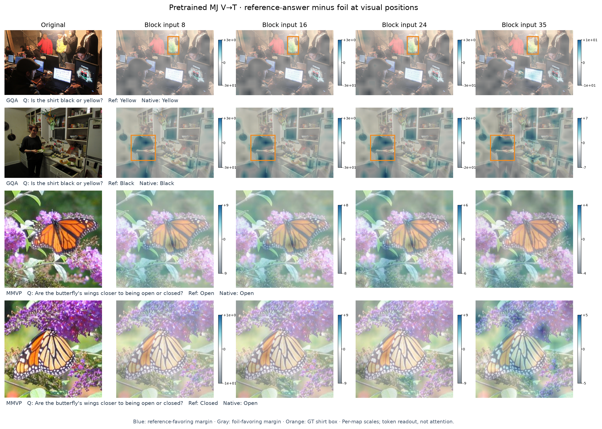
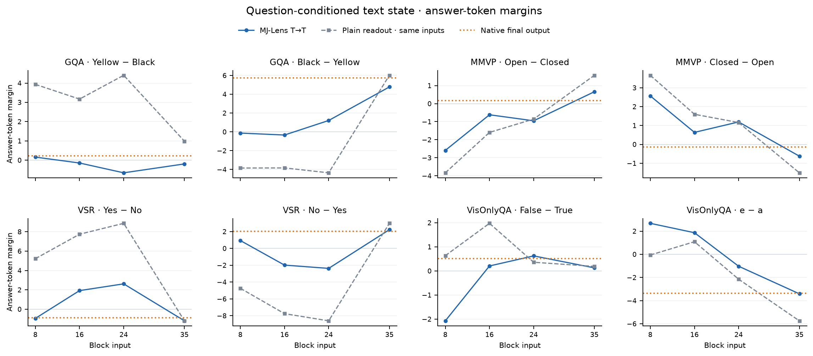
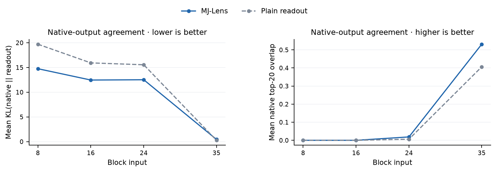

# Multimodal J-Lens

[Home](../../README.md) / [Methods](README.md) / Multimodal J-Lens

Read intermediate decoder states through separate text-to-text,
visual-to-text, text-to-visual and visual-to-visual Jacobian transports.
Visual outputs require a model with a discrete image-generation codebook.

## Principle

MJ-Lens separates the source position's modality from the output channel.
For a prompt $p$, let $A_p^{m,n}$ contain the valid source/target pairs
$(t,t')$ with source modality $m$, output modality $n$, and $t' \geq t$.
The calibrated operator is

$$
J_\ell^{m\to n}
= \frac{1}{P}\sum_{p=1}^{P}
\frac{1}{|A_p^{m,n}|}
\sum_{(t,t')\in A_p^{m,n}}
\frac{\partial h_{\mathrm{final},t'}}{\partial h_{\ell,t}}.
$$

Each prompt receives equal weight after averaging its admissible pairs.
This differs from the existing [Jacobian Lens](jacobian_lens.md), whose
estimator sums current/future targets before averaging sources. The two
artifacts are distinct and cannot be substituted for one another.

For MJ-Lens, layer $\ell$ means the **input to decoder block** $\ell$;
the target is the input to the actual final RMSNorm. Other lens guides use
post-block residual indices. Read `probe.describe()["methods"]["lens.mj"]`
to select the MJ block-input sites for a model.

An understanding model supplies $J^{T\to T}$ and $J^{V\to T}$, decoded by
its actual final normalization and text vocabulary head. A unified model
with a discrete image head additionally supplies $J^{T\to V}$ and
$J^{V\to V}$. A visual encoder or an image-input marker does not by itself
provide an image-generation alphabet.

For the supported two-layer GELU image head,

$$
\mathrm{head}(x)=W_2\,\mathrm{GELU}(W_1x+b_1)+b_2,
\qquad
W_{\mathrm{eff}}=W_2\,\mathrm{diag}\!\left(
\frac{1}{N}\sum_{t=1}^{N}\mathrm{GELU}'(W_1x_t+b_1)
\right)W_1.
$$

Calibration averages the derivative at sampled normalized visual states;
it does not differentiate once at their mean. The default visual readout
is the paper's bias-free $W_{\mathrm{eff}}\,\mathrm{norm}(Jh)$.
`native(...)` retains the full nonlinear head, and `affine(...)` adds a
calibration-mean offset for fidelity controls. Neither changes the default
MJ readout. Calibrate one visual readout and reuse it across output contexts.

**Analysis question:** How do modality-specific transport and the choice of
output alphabet change what an intermediate decoder state can reveal?

## API and parameters

The following signatures describe arguments. The complete scripts below
construct the models, inputs and methods before calling them.

```text
method = probe.lens.mj(
    *, layers=None, source="visual", target="text",
    visual_readout=None, context=None, binding=None,
)
method = method.fit(inputs, *, dim_batch=32, skip_first=0, exclude_last=False)
method = method.fit_batches(
    input_batches, *, directory=None, dim_batch=32, resume=False,
    checkpoint_every=8, skip_first=0, exclude_last=False,
)
result = method.run(inputs, *, tokens=None)
dictionary = method.dictionary(layer, *, token_ids=None)
method.save(directory)
method = method.load(directory)
```

| Parameter | Default | Meaning and constraints |
| --- | --- | --- |
| `layers` | `None` | All declared MJ block-input indices. An integer or unique nonempty list selects a subset. |
| `source` | `"visual"` | `"visual"` or `"text"`: modality of states being read and of calibration source positions. |
| `target` | `"text"` | `"text"` or `"visual"`: actual output channel. Visual targets require a declared image-generation head and calibrated `visual_readout`. |
| `visual_readout` | `None` | `LinearizedVisualReadout` built from this model's exact final norm and native image-head modules. Required for visual output. |
| `context` | `None` | Defaults to `"text_output"` for a text target and `"image_output"` for a visual target. `MJBatch.context` must match. Context names identify separate calibration protocols. |
| `binding` | `None` | Identity mapping. Saving/resuming requires explicit `model_revision`, `tokenizer_id` and `calibration_id`; visual artifacts also require `codebook_id`. Use immutable revisions/data hashes. The runner binds the source site, output channel and readout. |
| `inputs` / `input_batches` | Required | Native dictionaries, `ProbeInputs`, or `MJBatch` objects. A corpus iterable must be deterministic and re-iterable for resume. |
| `dim_batch` | `32` | Positive number of exact output-basis VJPs grouped per backward call. Changes memory/work scheduling, not an approximation rank. |
| `skip_first` | `0` | Nonnegative number of initial valid expanded positions excluded from calibration. |
| `exclude_last` | `False` | Exclude the last valid position from both source and target selections. |
| `directory` | `None` | Save resumable accumulation, prompt counts, split-half diagnostics and fitted artifacts here. Use a new directory for a new experiment. |
| `resume` | `False` | Resume only matching layer/modality/context/identity/exclusion settings. Inputs must be the same ordered corpus. |
| `checkpoint_every` | `8` | Positive number of input batches between resumable checkpoints. |
| `tokens` | `None` | By default read every valid source-modality position. A common selector or boolean mask can restrict them; selecting another modality raises an error. |
| `layer` | Required for `dictionary` | One fitted MJ block-input index. |
| `token_ids` | `None` | Optional nonempty integer subset of text vocabulary IDs or visual codebook IDs for dictionary construction. These are separate ID spaces. |

`fit(...)` replaces a previous estimate. Use `fit_batches(...)` to average
a dataset rather than calling `fit` repeatedly. Every prompt must contain an
admissible causal source/target pair after masking and exclusions. Short,
empty or disjoint selections fail explicitly. The model remains frozen;
this is derivative estimation, not SAE training or backbone fine-tuning.
Exact calibration still scales with hidden width and can be expensive for
large models. It must run outside `torch.inference_mode()`.

### Declaring output positions

```text
batch = MJBatch(inputs, target_masks={}, context="text_output")
```

| Parameter | Meaning |
| --- | --- |
| `inputs` | Native model inputs or `ProbeInputs` with expanded decoder coordinates. |
| `target_masks` | Optional `{"text": mask, "visual": mask}` with boolean `[batch, expanded_sequence]` tensors. Masks may not select padding. Text defaults to the layout's text positions; visual targets must always be explicit. |
| `context` | Nonempty protocol name matching the method's context. Non-text contexts require an explicit `MJBatch`. |

For teacher-forced Janus image generation,
`prepare_janus_generation(probe, prompt_inputs, codes)` builds this batch.
`prompt_inputs` must contain unpadded text prompt IDs and an optional all-one
attention mask. `codes` is a long `[batch, visual_positions]` tensor with at
least two actual visual code IDs. A state carrying code $i$ predicts code
$i+1$; the last code has no supplied successor and is excluded from targets.
The last text prompt state is not relabeled as a visual position.

### Visual readout calibration

```text
readout = fit_visual_readout(probe, image_output_batches, *, binding)
# Equivalently, with explicitly supplied native modules:
readout = LinearizedVisualReadout(norm, first_projection, activation, last_projection, *, binding=None)
readout = readout.fit(normalized_visual_states, *, mask=None)
readout = readout.update(normalized_visual_states, *, mask=None)
linear_logits = readout(raw_hidden)
native_logits = readout.native(raw_hidden)
affine_logits = readout.affine(raw_hidden)
readout.save(path)
readout = readout.load(path)
```

| Parameter or property | Meaning |
| --- | --- |
| `image_output_batches` | `MJBatch` objects with context `"image_output"` and actual visual output masks; the helper captures and normalizes final visual states. |
| `norm` | This model's exact final normalization. |
| `first_projection` / `last_projection` | Native `nn.Linear` image-head projections, including their original biases for calibration/native controls. |
| `activation` | Native `nn.GELU` (`"none"` or `"tanh"`) or the audited Transformers `GELUActivation`. Other nonlinear heads require their own implementation. |
| `binding` | Nonempty `model_id`, `readout_id`, `calibration_id`; any additional identity fields are retained and checked. |
| `normalized_visual_states` | Already normalized `[..., hidden]` states. `fit` resets; `update` accumulates positions with their actual sample counts. |
| `mask` | Optional boolean mask matching every axis except hidden; must select at least one position. |
| `raw_hidden` | Unnormalized hidden states. The callable and fidelity controls apply `norm` once. |
| `weight` / `dictionary_weight` | Effective `[visual_codebook, hidden]` matrix. |
| `mean_slope` / `n_samples` | Calibrated per-channel mean derivative / number of selected visual positions. |
| `path` | A calibration-only artifact; native model parameters are not serialized. Loading checks binding, dimensions, activation and exact native parameter fingerprint. |

## Complete pretrained VLM example: report photographs and questions

Run from a checkout containing this method and the bundled
[report input manifest](../../demos/assets/mj_report_samples.json). This example
uses **Qwen2.5-VL-3B-Instruct**, two real COCO calibration image/caption pairs,
and the two separate GQA shirt questions from the technical report. The full
[script](../../examples/tutorials/lens_mj.py) and
[notebook](../../demos/10_mj_lens.ipynb) use 32 independent calibration images
and all eight report cases: GQA, MMVP, VSR and VisOnlyQA.

Install `python -m pip install -e ".[transformers,visualization]"`. A CUDA GPU
is recommended: exact VJPs scale with the decoder width, source layers and
calibration corpus. Changing the number of calibration images changes the
experiment and its artifact identity; it does not select a different model.

```python
import hashlib
import json
import os
from pathlib import Path
from urllib.request import urlopen

import matplotlib.pyplot as plt
import torch
from PIL import Image
from transformers import AutoModelForImageTextToText, AutoProcessor
from vlmprobe import MJBatch, Prober, visual_grid
from vlmprobe.visualization import (
    plot_lens_heatmap, plot_mj_text_comparison, plot_mj_visual_readout,
)

ROOT = next(p for p in (Path.cwd().resolve(), *Path.cwd().resolve().parents)
            if (p / "demos/assets/mj_report_samples.json").is_file())
OUT = ROOT / "outputs/mj-qwen-api"
CACHE = Path(os.environ.get("VLM_PROBING_DATA_CACHE",
                           str(Path.home() / ".cache/vlmprobe/coco_calibration")))
OUT.mkdir(parents=True, exist_ok=True)
CACHE.mkdir(parents=True, exist_ok=True)
MODEL_ID = "Qwen/Qwen2.5-VL-3B-Instruct"
DEVICE = "cuda:0" if torch.cuda.is_available() else "cpu"
PIXELS, CAPTION_LIMIT = 224**2, 24

def checksum(path):
    return hashlib.sha256(Path(path).read_bytes()).hexdigest()

report_file = ROOT / "demos/assets/mj_report_samples.json"
calibration_file = ROOT / "demos/assets/mj_calibration_coco.json"
cases = json.loads(report_file.read_text())["cases"][:2]
training_records = json.loads(calibration_file.read_text())["samples"][:2]
heldout_hashes = {case["image_sha256"] for case in cases}
for record in training_records:
    assert record["image_sha256"] not in heldout_hashes
    path = CACHE / record["file_name"]
    if not path.exists():
        with urlopen(record["image_url"], timeout=120) as response:
            path.write_bytes(response.read())
    assert checksum(path) == record["image_sha256"], path
    record["local_image"] = path
for case in cases:
    assert checksum(ROOT / case["image_path"]) == case["image_sha256"]

model = AutoModelForImageTextToText.from_pretrained(
    MODEL_ID, dtype=torch.float32, attn_implementation="eager",
).to(DEVICE).eval().requires_grad_(False)
processor = AutoProcessor.from_pretrained(MODEL_ID, use_fast=False)
tokenizer = processor.tokenizer
probe = Prober(model, processor)
revision = getattr(model.config, "_commit_hash", None)
if not revision:
    raise ValueError("Use an immutable Hub revision or verified local checkpoint identity")
layer = max(probe.describe()["methods"]["lens.mj"]["sites"])

def prepare(image, question):
    messages = [{"role": "user", "content": [
        {"type": "image"}, {"type": "text", "text": question},
    ]}]
    prompt = processor.apply_chat_template(messages, tokenize=False,
                                           add_generation_prompt=True)
    native = dict(processor(text=prompt, images=image, return_tensors="pt",
                            min_pixels=56**2, max_pixels=PIXELS))
    native = {key: value.to(DEVICE) if isinstance(value, torch.Tensor) else value
              for key, value in native.items()}
    return prompt, native

def caption_batch(record):
    image = Image.open(record["local_image"]).convert("RGB")
    prompt, prefix = prepare(image, "Describe this image in one sentence.")
    ids = tokenizer.encode(record["caption"], add_special_tokens=False)[:CAPTION_LIMIT]
    caption = tokenizer.decode(ids, skip_special_tokens=False)
    # Process the full teacher-forced sequence so native sequence metadata,
    # including mm_token_type_ids, remains aligned with input_ids.
    native = dict(processor(text=prompt + caption + tokenizer.eos_token,
                            images=image, return_tensors="pt",
                            min_pixels=56**2, max_pixels=PIXELS))
    boundary = prefix["input_ids"].shape[1]
    assert torch.equal(prefix["input_ids"].cpu(), native["input_ids"][:, :boundary])
    native = {key: value.to(DEVICE) if isinstance(value, torch.Tensor) else value
              for key, value in native.items()}
    targets = torch.zeros_like(native["input_ids"], dtype=torch.bool)
    targets[:, boundary - 1:-1] = True  # States predicting supplied caption/EOS.
    return MJBatch(native, target_masks={"text": targets}, context="text_output")

binding = {
    "model_id": MODEL_ID, "model_revision": str(revision),
    "tokenizer_id": MODEL_ID + "@" + str(revision),
    "calibration_id": "coco-report-api-v2:" + checksum(calibration_file)
                      + ":first2:pixels50176:cap24:float32",
}
methods = {}
for source in ("visual", "text"):
    method = probe.lens.mj(layers=[layer], source=source, target="text", binding=binding)
    method.fit_batches((caption_batch(record) for record in training_records), dim_batch=16)
    method.save(OUT / (source + "-to-text"))
    methods[source] = method

for case in cases:
    image = Image.open(ROOT / case["image_path"]).convert("RGB")
    _, inputs = prepare(image, case["prompt_question"])
    vt = methods["visual"].run(inputs)
    tt = methods["text"].run(inputs, tokens="last_prompt")
    answer = tokenizer.encode(case["answer_surface"], add_special_tokens=False)
    foil = tokenizer.encode(case["other_answer_surface"], add_special_tokens=False)
    assert len(answer) == len(foil) == 1  # These two fixed GQA choices are single tokens.
    grid = tuple(visual_grid(probe, inputs)["grids"][0]["grid_shape"])
    raw_grid = inputs["image_grid_thw"][0].tolist()
    patch = model.config.vision_config.patch_size
    size = (raw_grid[2] * patch, raw_grid[1] * patch)
    resized = image.resize(size, Image.Resampling.BICUBIC)  # Qwen still-image resize only.
    x, y, width, height = case["bbox_xywh"]
    sx, sy = size[0] / image.width, size[1] / image.height
    bbox = [x * sx, y * sy, width * sx, height * sy]
    ax = plot_mj_visual_readout(resized, vt, positive_token_id=answer[0],
        negative_token_id=foil[0], grid_shape=grid, layer=layer, bbox=bbox,
        token_label=case["answer_surface"], negative_label=case["other_answer_surface"])
    ax.figure.savefig(OUT / (case["id"] + "-spatial.png"), dpi=160, bbox_inches="tight")
    top_ids = tt.tensors["logits"].argmax(-1)
    annotations = [[str(int(i)) + ": " + tokenizer.convert_ids_to_tokens(int(i)) for i in row]
                   for row in top_ids]
    ax = plot_lens_heatmap(tt, target_token_id=answer[0], annotations=annotations,
                           title=case["id"] + ": text-source last prompt")
    ax.figure.savefig(OUT / (case["id"] + "-text.png"), dpi=160, bbox_inches="tight")
    # MJ block-input layer L is post-block residual L-1 for these Qwen sites.
    plain = probe.lens.logit(layers=[layer - 1], tokens="last_prompt").run(inputs)
    final_layer = max(probe.spec.residuals)
    native = probe.lens.logit(layers=[final_layer], tokens="last_prompt").run(inputs)
    ax = plot_mj_text_comparison(tt, plain.tensors["logits"],
        native.tensors["logits"][0, 0], positive_token_id=answer[0],
        negative_token_id=foil[0])
    ax.figure.savefig(OUT / (case["id"] + "-controls.png"), dpi=160, bbox_inches="tight")
    print(case["id"], "V->T:", tuple(vt.tensors["logits"].shape),
          "T->T:", tuple(tt.tensors["logits"].shape),
          "exact displayed token:", repr(tokenizer.convert_ids_to_tokens(answer[0])))
plt.show()

restored = probe.lens.mj(layers=[layer], source="visual", target="text", binding=binding)
restored.load(OUT / "visual-to-text")
```

The shorter API example above uses two calibration images; the report-case
walkthrough uses the manifest's first 32. Both keep showcase images out of
fitting and retain their raw-byte checksums. The calibration source is official
**COCO val2014**, partitioned internally for calibration; `split="train"` in
this manifest does not mean official COCO train2014.

The `V->T` display reads **decoder image-token states**, not the visual encoder
itself. In this causal image-then-question template, an image position precedes
the question and cannot attend to it. The question chooses which vocabulary
contrast is displayed, but the image-token state is not retrospectively
question-conditioned. The `T->T` readout at the last prompt position can use the
image and the complete question. The full walkthrough compares this readout
with both a plain lens at the same source site and the actual final output.

Qwen2.5-VL and Qwen3-VL supply these two text-output operators. They do not
supply the discrete image-generation alphabet required for `T->V`, `V->V` or
a text-versus-visual dictionary modality index. Use the native Janus image head
for those operations.

## Unified model example: Janus visual output

This complete example uses the native Transformers checkpoint conversion
`deepseek-community/Janus-Pro-1B`. The original `deepseek-ai` repository's
custom `MultiModalityCausalLM` class is not this native adapter contract.
The example samples actual codebook outputs, fits the head on visual output
positions, then calibrates visual-to-visual transport. Generation is complete;
only a 16-code prefix is used for this small calibration demonstration.

```python
import hashlib
from pathlib import Path

import matplotlib.pyplot as plt
import torch
from transformers import AutoProcessor, JanusForConditionalGeneration
from vlmprobe import Prober, fit_visual_readout, decode_mj_codes
from vlmprobe.adapters import prepare_janus_generation

MODEL_ID = "deepseek-community/Janus-Pro-1B"
DEVICE = "cuda:0" if torch.cuda.is_available() else "cpu"
DTYPE = torch.bfloat16 if DEVICE.startswith("cuda") else torch.float32
OUT = Path("outputs/mj-janus")
OUT.mkdir(parents=True, exist_ok=True)
model = JanusForConditionalGeneration.from_pretrained(
    MODEL_ID, dtype=DTYPE, attn_implementation="eager",
).to(DEVICE).eval()
processor = AutoProcessor.from_pretrained(MODEL_ID)
probe = Prober(model, processor)

def generate_replay(description):
    messages = [{"role": "user", "content": [{"type": "text", "text": description}]}]
    prompt = processor.apply_chat_template(messages, tokenize=False, add_generation_prompt=True)
    native = processor(text=prompt, generation_mode="image", return_tensors="pt").to(DEVICE)
    with torch.no_grad():
        codes = model.generate(**native, generation_mode="image", do_sample=False,
                               guidance_scale=5.0, return_dict_in_generate=False)
    prompt_inputs = {"input_ids": native["input_ids"],
                     "attention_mask": native["attention_mask"]}
    return prompt_inputs, codes

descriptions = ["A red square on a white background.", "A green oval on a white background."]
training_pairs = [generate_replay(description) for description in descriptions]
training_batches = [prepare_janus_generation(probe, prompt, codes[:, :16])
                    for prompt, codes in training_pairs]
revision = str(getattr(model.config, "_commit_hash", None) or "local-checkpoint")
data_hash = hashlib.sha256("\n".join(descriptions).encode()).hexdigest()
binding = {
    "model_id": MODEL_ID, "model_revision": revision,
    "tokenizer_id": processor.tokenizer.name_or_path + "@" + revision,
    "codebook_id": MODEL_ID + "@" + revision + ":vqmodel",
    "calibration_id": "generated-shapes-v1:" + data_hash,
}
readout_binding = {"model_id": MODEL_ID + "@" + revision,
                   "readout_id": "model.generation_head",
                   "calibration_id": binding["calibration_id"]}
readout = fit_visual_readout(probe, training_batches, binding=readout_binding)
readout.save(OUT / "visual-readout.pt")
layers = [probe.describe()["methods"]["lens.mj"]["sites"][-1]]
method = probe.lens.mj(layers=layers, source="visual", target="visual",
                       context="image_output", visual_readout=readout, binding=binding)
method.fit_batches(training_batches, directory=OUT / "transport", dim_batch=16)

test_prompt, test_codes = generate_replay("A blue circle on a white background.")
heldout = prepare_janus_generation(probe, test_prompt, test_codes)
result = method.run(heldout)
side = model.config.vq_config.num_patches
images, grid_codes = decode_mj_codes(result, grid=(side, side),
                                    decoder=probe.spec.mj.decode_visual_codes)
print("code IDs:", tuple(grid_codes.shape), "decoded images:", tuple(images.shape))
# The native Janus decoder returns channel-last images in [-1, 1].
plt.imshow(((images[0, 0].float().cpu() + 1) / 2).clamp(0, 1))
plt.axis("off")
plt.savefig(OUT / "mj-visual.png", dpi=160, bbox_inches="tight")
plt.show()
```

Use a larger, independent rollout corpus and held-out comparisons with
`readout.native(...)` before interpreting a visual reconstruction. The visual
head and Jacobian are separate approximations. A complete code grid must come
from distinct visual source positions; `decode_mj_codes` rejects text-source
results and mismatched grids. It never tiles one text state to create an image.

## Dictionaries and controlled modality index

For final RMSNorm gain $g$, the text and visual dictionaries are the row atoms
of $U_T=W_U\,\mathrm{diag}(g)J^{m\to T}$ and
$U_V=W_{\mathrm{eff}}\,\mathrm{diag}(g)J^{m\to V}$. Both use the same source
layer, modality and hidden coordinates. Dictionary construction keeps the
learned gain; actual logits additionally keep the input-dependent RMS division.
The gain-only dictionary formula is not a generic LayerNorm substitution.

The sparse nonnegative decomposition and raw modality index are

$$
h\approx\sum_i\alpha_i u_i,\qquad \alpha_i\geq0,\quad
\|\alpha\|_0\leq K,\qquad
\mathrm{MI}(h)=\frac{\sum_{i\in V}\alpha_i\|u_i\|}
{\sum_i\alpha_i\|u_i\|}.
$$

```text
result = modality_index(
    activations, text_dictionary, visual_dictionary,
    *, k=25, seed=0, size_match=False, signed=False,
)
```

| Parameter | Default | Meaning |
| --- | --- | --- |
| `activations` | Required | Floating `[..., hidden]` source activations. |
| `text_dictionary` / `visual_dictionary` | Required | Floating `[atoms, hidden]` row dictionaries expressed in exactly those source coordinates. |
| `k` | `25` | Positive maximum number of selected atoms. |
| `seed` | `0` | Local deterministic seed for the orthogonal visual rotation and optional text subset; does not reset global RNG state. |
| `size_match` | `False` | Additionally subsample text atoms to the visual atom count. Requires at least as many text atoms; returns separate controls without replacing primary results. |
| `signed` | `False` | Must remain `False`; signed coefficients do not implement this index. Negative activation/atom coordinates remain valid. |

Import the helper with `from vlmprobe.lenses import modality_index`. Construct
the dictionaries with the two fitted methods' `.dictionary(layer)` calls.
The implementation normalizes atoms, selects nonnegative OMP supports, and
performs 64 projected-gradient NNLS iterations per support. Coefficients in
the result are converted back to original atom units. This finite solver is
an explicit library choice; the paper does not specify an exact solver.

Always report `excess_mi = raw_mi - rotated_mi`. The visual control applies a
random orthogonal rotation that preserves its row norms and Gram matrix.
`raw_mi` alone measures dictionary allocation and is not evidence of visual
semantic content. Zero reconstruction mass gives NaN with validity masks.
Also inspect the size-matched result and repeat the analysis with independently
calibrated odd/even prompt operators. The calibration report's split-half cosine
is a numerical diagnostic; it is not the paper's split-half MI/context comparison.
Large dictionaries and many positions can require substantial memory; select
an explicit modest set of source positions before decomposition.

## Outputs and visualization

`method.run(...)` returns `ProbeResult("mj_lens", ...)` with
`logits[L,N,V]`, `transported[L,N,D]`, `positions[N,2]` and layer/modality/context
metadata. `positions` uses `[batch, expanded_decoder_position]`; image tokens
are expanded model coordinates. Visual output adds `code_ids[L,N]`, whose
IDs belong to the visual codebook and cannot be passed to the text tokenizer.

`modality_index(...)` returns raw/rotated/excess MI, validity masks,
reconstructions, nonnegative coefficients, atom IDs and visual-atom masks.
Inactive support entries have ID `-1`. Size-matched atom IDs index its reduced
union; `size_matched_text_ids` maps text atoms back to the full dictionary.

Both plotting helpers return a Matplotlib `Axes` and accept an existing `ax`.
Import them from `vlmprobe.visualization`.

```text
ax = plot_mj_visual_readout(
    image, result, *, positive_token_id, negative_token_id=None,
    grid_shape, layer, bbox=None, token_label=None, negative_label=None,
    image_alpha=0.65, batch_index=0, alpha=0.85, colorbar=True,
    cmap=None, vmin=None, vmax=None, ax=None,
)
ax = plot_mj_text_comparison(
    mj_result, plain_logits, native_logits, *, positive_token_id,
    negative_token_id, labels=None, ax=None,
)
```

| Visual readout argument | Meaning |
| --- | --- |
| `image` / `grid_shape` | The actual processed image and its `(height, width)` visual-token grid. Selected native positions are sorted and must fill this grid exactly. Split multi-image or tiled inputs explicitly. |
| `result` / `layer` | A visual-to-text MJ result and an actual fitted block-input index from its metadata. |
| `positive_token_id` / `negative_token_id` | Display a vocabulary logit, or their signed logit difference when both IDs are supplied. |
| `bbox` | Optional `(x, y, width, height)` in the supplied processed image's coordinates; drawn in orange. Transform source annotations before passing them. |
| `token_label` / `negative_label` | Optional labels for the exact chosen tokenizer pieces. |
| `batch_index` | Select one batch item; defaults to `0`. |
| `image_alpha` / `alpha` | Photograph opacity / heatmap opacity, respectively. |
| `colorbar` / `cmap` / `vmin` / `vmax` | Display controls. The default signed palette uses cyan-to-blue for positive and pale gray for negative values; limits are computed per map unless supplied. |

| Text comparison argument | Meaning |
| --- | --- |
| `mj_result` | A text-to-text MJ result with exactly one prediction position. |
| `plain_logits` | Final normalization/head applied directly to the same source states, in the same layer order: `[L,V]` or `[L,1,V]`. |
| `native_logits` | The model's final vocabulary vector at that same prediction position. |
| `positive_token_id` / `negative_token_id` | Plot their raw signed logit difference for MJ, plain and native readouts. |
| `labels` | Optional tick labels, one per captured MJ layer. |

The visual helper preserves signed values; independent color scaling does not
make map intensities comparable across layers or models. The text helper keeps
raw margins without normalizing individual curves. Neither helper computes an
attention map, causal attribution or bounding-box prediction.

## Reading the report-case figures

The [executable tutorial](../../examples/tutorials/lens_mj.py) and
[notebook](../../demos/10_mj_lens.ipynb) load the pretrained Qwen checkpoint,
construct native image/question inputs, calibrate on independent COCO captions,
and compute the report readouts before plotting. The notebook contains all
steps; it does not load saved showcase tensors or pre-rendered results.

The supplied execution uses 32 independent calibration images and eight held-out
questions on Qwen2.5-VL-3B-Instruct. It illustrates both useful readouts and
failures: intermediate text-state vocabulary predictions are often unrelated
tokens, despite stable split-half operators. At block input 35, MJ's top token
matches the reference in 4 of 8 cases, versus 5 of 8 for the plain readout and
native model. These are case counts, not benchmark accuracy. MJ has greater
native top-20 overlap at this layer but worse mean KL divergence; the two
fidelity measurements should be inspected separately.

The first figure aligns vocabulary contrasts with the native Qwen image grid.
Original photographs and supplied GQA target boxes are shown alongside the
measured readouts. A vocabulary contrast is not an attention map or proof of
causal localization; no boxes are invented for MMVP, VSR or VisOnlyQA.



The text comparison reads the question-conditioned last prompt state. It
compares MJ-Lens with the plain final normalization/head applied to the same
source state and with the model's actual final output. Token labels identify
exact tokenizer pieces, not automatically inferred whole-word concepts.



The fidelity figure records agreement with the native final distribution.
Agreement depends on the layer, calibration data and case; this small shared
case study does not establish a universal faithfulness band or benchmark score.



No external pretrained MJ artifact is bundled or downloaded by `.load(...)`:
it loads this library's identity-bound calibration files. The Janus codebook
example is a separate execution path; the Qwen report walkthrough makes no
image-generation claim. Neither a vocabulary readout, reconstruction nor
modality index establishes a causal concept or a global-workspace claim.

Calibration reports distinguish previously accumulated and newly processed
prompts/batches. `elapsed_seconds` covers the current `fit_batches` call
(`elapsed_scope="this_fit_batches_call"`); a completed resume can process zero
new prompts and must not be interpreted as the cost of a fresh fit.

[Paper](https://openreview.net/forum?id=Xrp8mNku6R) ·
[Tensor implementation](../../src/vlm_probing/lenses/mj.py) ·
[Visual readout and controls](../../src/vlm_probing/lenses/mj_readout.py) ·
[Dataset calibration](../../src/vlm_probing/training/mj.py)
