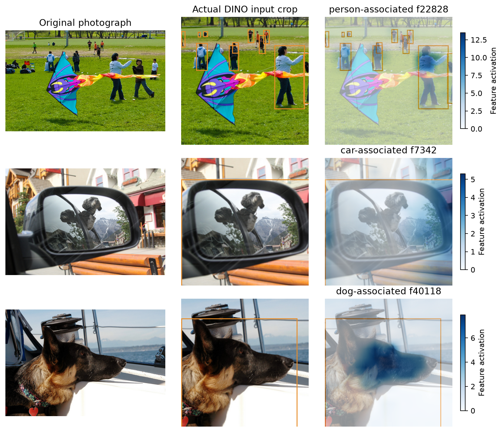
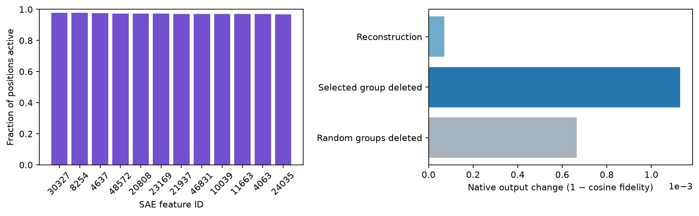

# Pretrained visual SAE walkthrough

[Home](../../../../README.md) / [SAE](../README.md) / Pretrained visual SAE

Open [the executable notebook](../../../../demos/11_sae_pretrained.ipynb) or run
[the same complete Python workflow](../../../../examples/tutorials/sae_pretrained.py):

```bash
python -m pip install -e '.[transformers,sae,visualization]'
python examples/tutorials/sae_pretrained.py
```

The walkthrough loads published weights, computes new activations from original
photographs, selects features on independent calibration images, and calls the
library's [evaluation pipeline](../evaluation/README.md). Neither the backbone
nor the SAE is trained. It imports no official SAE toolkit.

## Checkpoint and input contract

| Item | Exact recipe |
| --- | --- |
| Backbone | [facebook/dino-vitb16](https://huggingface.co/facebook/dino-vitb16), revision `f205d5d8e640a89a2b8ef0369670dfc37cc07fc2` |
| Dictionary | [Prisma DINO ReLU, block 11](https://huggingface.co/Prisma-Multimodal/DINO-vanilla-x64-all_patches_11-resid_post-1085-99), revision `3e3ea0cdcde4186db8069f4fe0ce219e8693155a` |
| Source observation | `blocks.11.hook_resid_post`; native `encoder.layer.11` output, before final normalization |
| Dimensions | 768 activation coordinates, 49,152 dictionary features |
| Source normalization | Per-position layer normalization: sample std (`correction=1`), denominator `std + 1e-5`; reconstruction restores original std and mean |
| Image preprocessing | Shortest-edge bicubic resize to 224, rounded center crop to 224×224, RGB `[0,1]`, ImageNet mean/std |
| Tutorial positions | 14×14 row-major patches, excluding CLS; the published dictionary was trained with all positions |
| Calibration | 32 fixed official COCO train2017 images, used for feature selection, RMS, firing frequencies and reconstruction reference mean |
| Held out | Original COCO val2017 images 14439 (person), 263463 (car), 532575 (dog) from the technical report |

The versioned [raw input manifest](../../../../demos/assets/sae_report_samples.json)
contains image URLs, hashes and annotations. Calibration and held-out images are
disjoint by image ID **and** raw SHA-256. Boxes are transformed through the actual
resize/crop; they are not drawn on model inputs. The notebook checks source tensor
formula parity on fresh activations before extracting its results.

An 8 GB CUDA GPU is recommended. Downloads total approximately 343 MB for DINO,
302 MB for the dictionary, and several MB for calibration photographs. CPU
execution is supported but slower. Historical Prisma checkpoint envelopes require
PyTorch 2.6 or later; the restricted loader substitutes one inert config container
and never executes the upstream class or falls back to unrestricted pickle loading.

## Workflow and outputs

1. Verify original images and input separation; download missing raw photographs.
2. Load pinned DINO weights and reproduce the author's processor explicitly.
3. Convert author tensors with `import_checkpoint(source_format="prisma", ...)`,
   then load the native artifact using `probe.sae.load(..., binding=..., tokens="visual")`.
4. Compute calibration activations. Select category-associated feature IDs by an
   inside-versus-outside box score, requiring activity on at least three calibration
   images. Freeze IDs and frequency-matched random controls before held-out inference.
5. Compute fresh held-out features and call `evaluation.sae.evaluate(...)` for
   reconstruction, sparsity and native output interventions. Call
   `evaluation.sae.localization(...)` with explicitly aligned masks.
6. Plot actual crops with `plot_sae_feature_overlay(...)` and feature firing
   frequency with `plot_sae_evaluation(...)`. Compare reconstruction and deletion
   to exact no-op and random-feature controls; verify artifact reload equality.

Default outputs are under `outputs/sae_pretrained/`: feature/evaluation figures,
`frozen_selection.json`, strict JSON/CSV reports, a native SAE artifact,
`tutorial_summary.json` and `status.json`. They are recomputed rather than loaded
from a saved probe snapshot.

| Optional environment variable | Meaning |
| --- | --- |
| `VLM_PROBING_DEVICE` | Default `cuda:0` when available, otherwise `cpu` |
| `VLM_PROBING_OUTPUT` | Output directory; defaults to `outputs/sae_pretrained` |
| `VLM_PROBING_DATA_CACHE` | Cache root for downloads; defaults to `~/.cache/vlmprobe/sae_pretrained` |
| `VLM_PROBING_COCO_DIR` | Existing COCO root containing `train2017/`; every file is hash checked |
| `VLM_PROBING_DINO_MODEL` | Directory of the exact pinned DINO files; hashes remain mandatory |
| `VLM_PROBING_DINO_SAE` | Directory containing the exact pinned `weights.pt` and `config.json` |
| `VLM_PROBING_CPU_THREADS` | CPU worker threads, default 4 |

## Reading the results

Feature IDs identify learned dictionary coordinates, not human-authored concept
labels. Calibration association may generalize poorly; inactive held-out maps are
retained. Localization, residual reconstruction and output interventions answer
different questions and should be inspected separately.





The intervention metric is cosine fidelity of DINO's native final-normalized
CLS-plus-mean-patch representation. It is not a language answer or concept-accuracy
metric. At block 11, patch edits leave CLS unchanged because no later attention
block follows; the pooled patch representation can change. The walkthrough reports
both effects. Three fixed images demonstrate the API and are not a benchmark.

[Pretrained loading](../loading.md) · [Training your own SAE](../training/README.md) ·
[Evaluation API](../evaluation/README.md) · [Model cards](../models/README.md)
